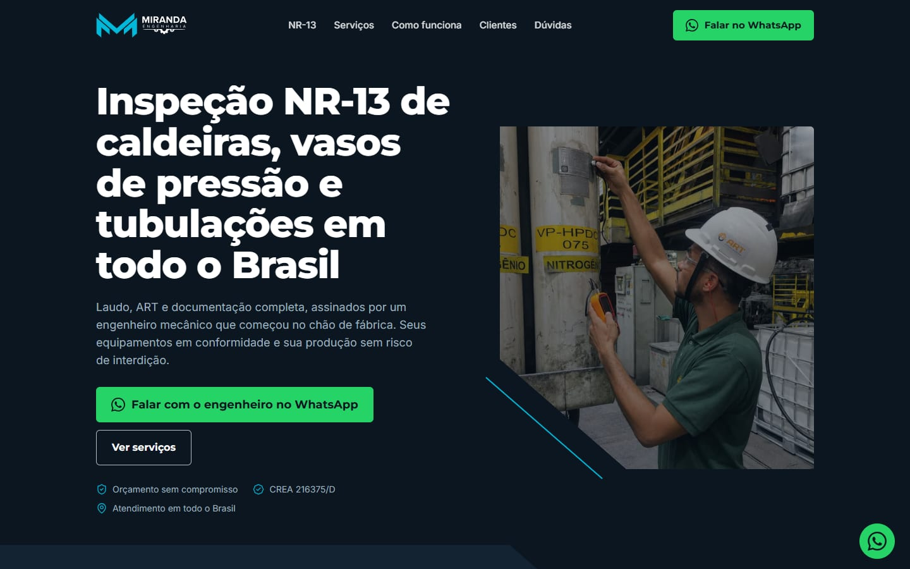
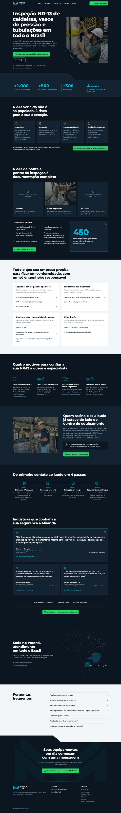

# Miranda Engenharia — Landing page NR-13

Landing page de conversão da Miranda Engenharia (inspeção NR-13 de caldeiras, vasos de pressão e tubulações). Objetivo único: levar o visitante a falar com o engenheiro pelo WhatsApp.

**Site online:** https://usergabri.github.io/miranda-landing-nr13/

  
  &nbsp;
  

## Stack

- Astro 7 (saída estática) + Tailwind CSS 4 com os tokens da identidade em `tailwind.config.mjs`
- TypeScript, JavaScript puro nos componentes (sem framework de UI)
- Fontes Montserrat e Inter auto-hospedadas (`@fontsource`), imagens otimizadas com `astro:assets`
- SEO: JSON-LD (`ProfessionalService` + `FAQPage`), Open Graph, sitemap e robots.txt
- GTM carregado só após o aceite de cookies (`PUBLIC_GTM_ID`)

Lighthouse mobile: Performance 95 · Acessibilidade 100 · Boas práticas 100 · SEO 100.

## Comandos

| Comando | O que faz |
| --- | --- |
| `npm run dev` | Servidor de desenvolvimento |
| `npm run build` | Gera o site estático em `dist/` |
| `npm run preview` | Serve o `dist/` localmente |
| `npm run assets:gen` | Regenera logos, favicons, mapa e ícones a partir de `assets/` |
| `node scripts/gerar-og.mjs` | Gera a imagem de compartilhamento (`public/og-image.png`) |
| `node scripts/screenshots.mjs` | Screenshots e checagem de rolagem horizontal (requer o site servido) |
| `node scripts/auditoria.mjs` | Confere links de WhatsApp, cores, títulos, teclado e acordeões |

## Publicação

- **GitHub Pages:** automático a cada push na `main` (`.github/workflows/deploy-pages.yml`). O workflow define `SITE_URL` e `BASE_PATH` para a subpasta `/miranda-landing-nr13/`.
- **Vercel / cPanel:** `npm run build` e publique `dist/`. Defina `SITE_URL` com o domínio final (veja `.env.example`). Sem `BASE_PATH`, o site é gerado para a raiz do domínio.

## Pendências de conteúdo

- Marcadores ainda visíveis: `{{NOME_ENGENHEIRO}}`, `{{PRAZO_LAUDO}}`, `{{CNPJ}}`, `{{EMAIL}}`, `{{UF_3}}`, `{{UF_4}}` (em `src/data/site.ts`)
- Fotos reais de caldeira e de tubulação (hoje são placeholders)
- Logos dos clientes na seção de depoimentos (arquivos em `assets/logos-clientes/`)
- Confirmar autorização para citar a Nemak no depoimento completo
- Domínio definitivo
